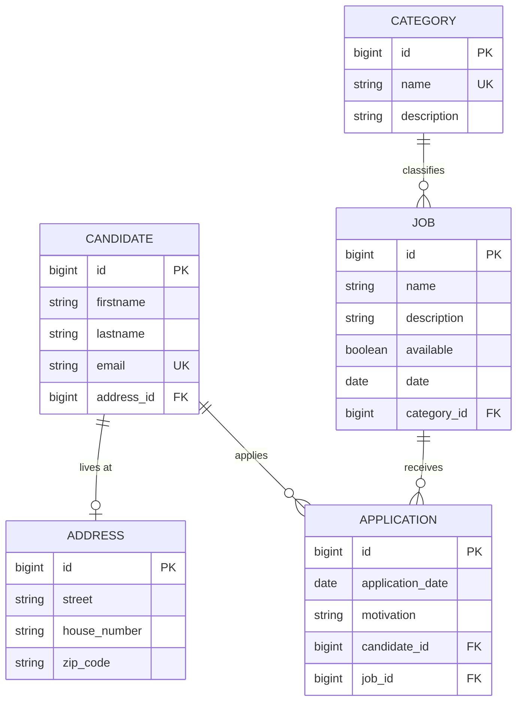

# AWD – Recruitment platform (monolithic version)

A **monolithic RESTful Spring Boot application** that brings together the three domains of the AWD project:

- **Candidate management**: candidates and addresses
- **Job management**: job offers and categories
- **Candidature management**: a candidate applies to a job

One application, **one MySQL database**, one Swagger documentation.
This is the **starting point** before the migration to a microservices architecture (candidat, job, candidature + Eureka).

---

## 🧩 Data model



An **application** (candidature) links a **candidate** to a **job**: a candidate can have several applications, and a job can receive several.

---

## ▶️ Getting started

### 1. Create the database
MySQL must be running on `localhost:3306` (user `root`, empty password by default).

```bash
mysql -u root -p < database/awd_db.sql
```
or import `database/awd_db.sql` into phpMyAdmin / MySQL Workbench.
The script creates the `awd_db` database, the 5 tables with their constraints, and sample data
(4 candidates, 3 categories, 5 jobs, 5 applications).

Different MySQL credentials? Change `spring.datasource.username` / `password` in `src/main/resources/application.properties`.

### 2. Run the application
```bash
mvn spring-boot:run
```

- Swagger UI: http://localhost:8083/swagger-ui.html
- OpenAPI JSON: http://localhost:8083/v3/api-docs/0-all

In Swagger UI, the **“Select a definition”** drop-down list (top right) shows
the whole API (`0-all`) or a single module (`1-candidat`, `2-job`, `3-candidature`): these are the future microservices.

`spring.jpa.hibernate.ddl-auto=none`: the SQL script creates the tables; Hibernate does not touch them.

---

## 📚 Endpoints

### Candidate management
| Method | URL | Description |
|---|---|---|
| GET | /api/candidates | List candidates |
| GET | /api/candidates/{id} | Get a candidate (with their address) |
| POST | /api/candidates | Create a candidate (address optional) |
| PUT | /api/candidates/{id} | Update a candidate |
| DELETE | /api/candidates/{id} | Delete a candidate (409 if they have applications) |
| PUT | /api/candidates/{id}/address/{addressId} | Assign an existing address |
| DELETE | /api/candidates/{id}/address | Unlink the address |
| GET / POST / PUT / DELETE | /api/addresses[/{id}] | Address CRUD |

### Job management
| Method | URL | Description |
|---|---|---|
| GET | /api/jobs?available=&categoryId= | List jobs (optional filters) |
| GET | /api/jobs/{id} | Get a job |
| POST | /api/jobs | Create a job |
| PUT | /api/jobs/{id} | Update a job |
| PATCH | /api/jobs/{id}/availability?available=false | Open / close a job |
| DELETE | /api/jobs/{id} | Delete a job (409 if it has applications) |
| GET / POST / PUT / DELETE | /api/categories[/{id}] | Category CRUD |
| GET | /api/categories/{id}/jobs | Jobs of a category |

### Candidature management
| Method | URL | Description |
|---|---|---|
| GET | /api/applications?candidateId=&jobId= | List applications (optional filters) |
| GET | /api/applications/{id} | Get an application (with a summary of the candidate and the job) |
| POST | /api/applications | Apply to a job |
| PUT | /api/applications/{id} | Update the motivation / date |
| DELETE | /api/applications/{id} | Withdraw an application |
| GET | /api/candidates/{id}/applications | Applications of a candidate |
| GET | /api/jobs/{id}/applications | Applications received for a job |

### Business rules
- A candidate can apply to the same job **only once** → `409 Conflict`
- Candidates can only apply to an **available** job (`available = true`) → otherwise `409 Conflict`
- `applicationDate` is optional (defaults to today) and cannot be in the future
- A candidate or a job that has applications cannot be deleted → `409 Conflict`
- Candidate emails and category names must be unique → `409 Conflict`

Errors are returned as RFC 7807 JSON: `400` validation, `404` not found, `409` conflict.

### Example
```json
POST /api/applications
{
  "candidateId": 4,
  "jobId": 1,
  "motivation": "I would like to join a team working with Spring Cloud.",
  "applicationDate": "2026-09-29"
}
```
Response `201 Created`:
```json
{
  "id": 6,
  "applicationDate": "2026-09-29",
  "motivation": "I would like to join a team working with Spring Cloud.",
  "candidate": { "id": 4, "firstname": "Lina", "lastname": "Mansour", "email": "lina.mansour@example.com" },
  "job": { "id": 1, "name": "Java Spring Boot Developer", "available": true, "category": "Software Development" }
}
```

---

## 🗂️ Project structure

The code is organised **by business domain** (*package by feature*): each package will become a microservice.

```
src/main/java/com/awd/monolith
├── AwdMonolithApplication.java
├── candidat/        → future CANDIDAT microservice
│   ├── controller/  CandidateController, AddressController
│   ├── dto/  entity/  mapper/  repository/  service/
├── job/             → future JOB microservice
│   ├── controller/  JobController, CategoryController
│   ├── dto/  entity/  mapper/  repository/  service/
├── candidature/     → future CANDIDATURE microservice
│   ├── controller/  ApplicationController
│   ├── dto/  entity/  mapper/  repository/  service/
└── common/
    ├── config/      OpenApiConfig (Swagger + one group per module)
    └── exception/   GlobalExceptionHandler, ResourceNotFoundException, ConflictException
database/awd_db.sql  database creation script
```

---

## 🔀 From monolith to microservices

Coupling points to break during the migration (look for them in the code):

| In the monolith | After the migration |
|---|---|
| One `awd_db` database shared by the 3 modules | One database per microservice |
| `Application` has `@ManyToOne` relations to `Candidate` and `Job` (real foreign keys) | `Application` only stores `candidateId` and `jobId` |
| `ApplicationService` calls `CandidateService` and `JobService` (in-memory Java call) | HTTP calls to CANDIDAT and JOB with **OpenFeign** + **Eureka** |
| A single transaction covers the candidate check, the job check and the save | No shared transaction anymore: unavailable services must be handled |
| `CandidateService` / `JobService` read the `application` table before a deletion | The candidature service must be queried (or orphan data is accepted) |
| A single port (8080) and a single Swagger | One port and one Swagger per service (8081, 8082, 8085…) |

---

## ✅ Tests
```bash
mvn test
```
The integration tests run on an in-memory H2 database (MySQL mode): MySQL is not needed to run the tests.

---

## 🏫 Educational context

### Instructor: [Badia Bouhdid](https://www.linkedin.com/in/badiabouhdid)

Project developed as part of the **Distributed Web Architecture **  course at **ESPRIT School of Engineering**.
